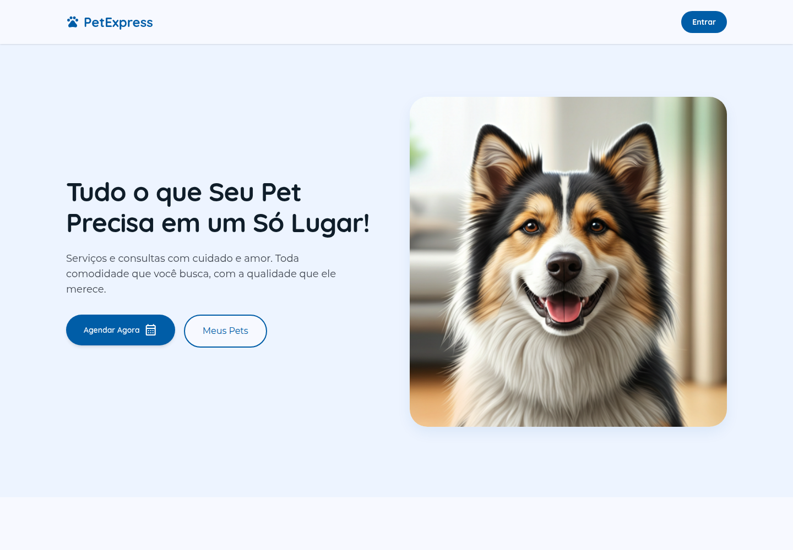
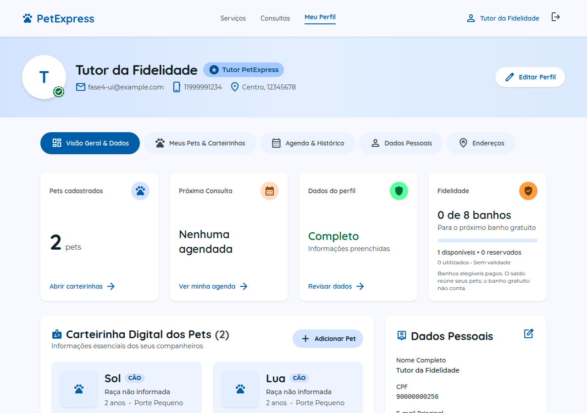
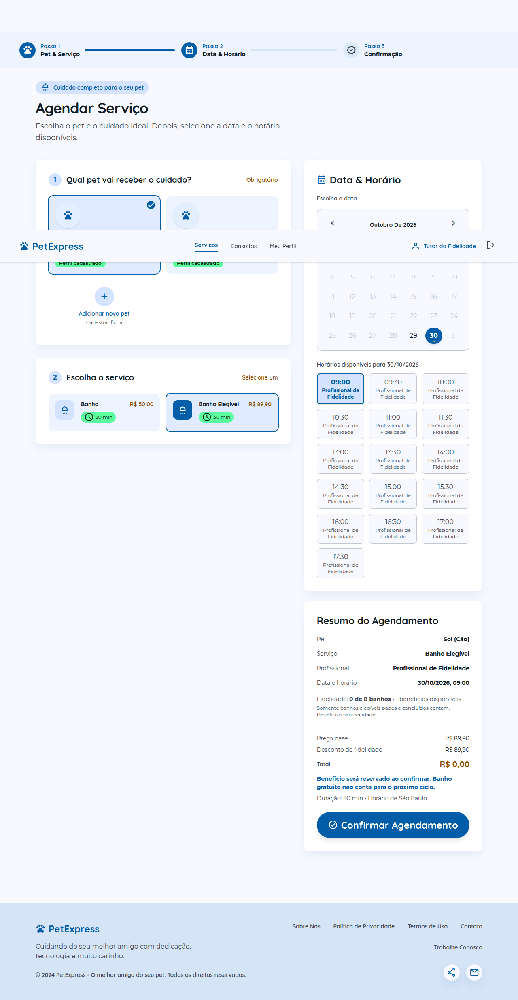
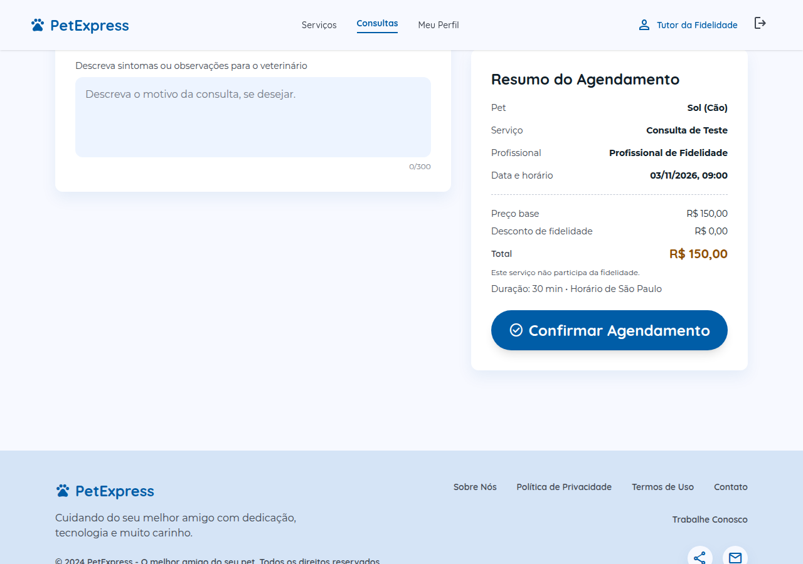
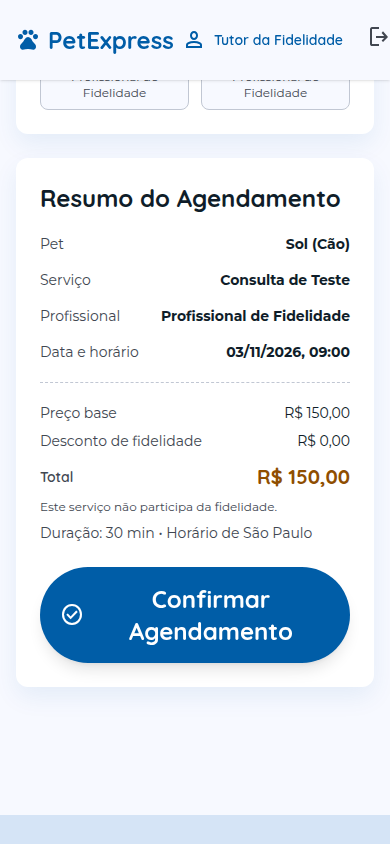
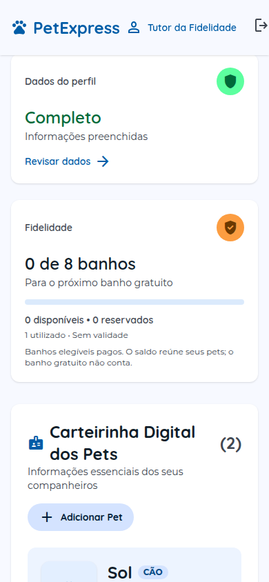

<p align="center">
  
</p>

<h1 align="center">PetExpress</h1>

<p align="center">
  Cuidado com os pets, organização para os tutores.<br />
  Sistema acadêmico de gestão de pet shop para a disciplina de Paradigmas de Programação II.
</p>

<p align="center">
  <a href="LICENSE"></a>
  <a href="package.json"></a>
  <a href="apps/frontend/package.json"></a>
  <a href="apps/frontend/package.json"></a>
  <a href="docker-compose.yml"></a>
  <a href="docker-compose.yml"></a>
</p>

<p align="center">
  <a href="#sobre-o-projeto">Sobre</a> ·
  <a href="#telas-do-projeto">Telas</a> ·
  <a href="#como-executar">Como executar</a> ·
  <a href="docs/README.md">Documentação</a> ·
  <a href="LICENSE">Licença</a>
</p>

## Sobre o projeto

O PetExpress conecta cadastro de tutores e pets, agendamento de serviços e consultas, agenda e fidelidade em uma aplicação web responsiva. Os dados são persistidos em PostgreSQL, com autenticação por sessão em Redis e controle de acesso por papel e titularidade.

### Funcionalidades

| Área | O que já está implementado |
| --- | --- |
| Autenticação | Cadastro, login com senha, Google via Firebase e conclusão de perfil |
| Perfil do tutor | Edição de dados pessoais e gerenciamento de endereços |
| Pets | Cadastro, consulta, edição e remoção, com validação de titularidade |
| Serviços e consultas | Catálogo da API, profissionais habilitados, calendário e horários disponíveis |
| Agendamentos | Criação, cancelamento, reagendamento, histórico e auditoria transacional |
| Fidelidade | A cada oito banhos elegíveis pagos e concluídos, um gratuito; saldo compartilhado entre os pets do tutor |
| Administração | APIs para catálogo, equipe, expediente, bloqueios e ajustes de fidelidade |

**Escopo atual:** fases 1–4 implementadas. O painel visual de administração, pagamentos e prontuário são próximos passos. A página inicial ainda contém conteúdo ilustrativo; os fluxos de cadastro, perfil e agendamento usam dados da API.

## Telas do projeto

### Página inicial



### Perfil, pets e fidelidade



<details>
<summary><strong>Ver serviços, consultas e versão mobile</strong></summary>

#### Agendamento de serviços

Escolha do pet, serviço, profissional e horário, com prévia do valor e aplicação do benefício.



#### Consultas veterinárias



#### Experiência no celular

<p align="center">
  
  
</p>

</details>

As capturas dos fluxos autenticados usam dados de teste. Veja a [galeria e a origem das imagens](docs/capturas/README.md).

## Tecnologias

| Camada | Ferramentas |
| --- | --- |
| Interface | React 19, TypeScript, Vite 6, React Router 7 e Tailwind CSS 4 |
| API | Node.js, Express 4 e TypeScript |
| Persistência | Prisma 5 e PostgreSQL 16 |
| Sessões | Redis 7 e cookies HttpOnly |
| Login Google | Firebase Authentication e Firebase Admin |
| Documentação da API | Swagger / OpenAPI |
| Qualidade | Vitest, Supertest, ESLint e TypeScript |
| Monorepo | pnpm workspaces e Turborepo |
| Infraestrutura local | Docker Compose |

## Como executar

### Pré-requisitos

- Node.js 22 e pnpm 10.11.0.
- Docker com Docker Compose.
- Firebase configurado para testar o login Google; o login com senha pode ser usado sem essa integração.

### Instalação em uma base nova

Na raiz do repositório:

```bash
pnpm install
cp .env.example .env
cp apps/frontend/.env.example apps/frontend/.env
```

Confira as conexões no `.env` e deixe `FIREBASE_SERVICE_ACCOUNT_JSON` vazio enquanto não configurar o login Google. Os padrões do Compose são PostgreSQL em `15432` e Redis em `16379`.

```bash
docker compose up -d postgres redis
pnpm --filter @petshop/backend prisma:generate
pnpm --filter @petshop/backend exec prisma migrate deploy
```

Inicie em dois terminais, a partir da raiz:

```bash
# Terminal 1 — API
pnpm --filter @petshop/backend dev
```

```bash
# Terminal 2 — interface
pnpm --filter @petshop/frontend dev
```

| Serviço | Endereço local |
| --- | --- |
| Aplicação | <http://localhost:5173> |
| API / health check | <http://localhost:3000/> |
| Swagger | <http://localhost:3000/api-docs> |

O catálogo começa vazio. Provisione o primeiro ADMIN e cadastre serviços, profissionais e habilitações para disponibilizar horários. O [guia de desenvolvimento](docs/desenvolvimento/README.md) explica as variáveis, o bootstrap, os comandos e os testes. Para atualizar uma base existente, siga as [orientações de migração](docs/banco-de-dados/README.md#migrações).

## Estrutura do repositório

```text
apps/
  backend/         API Express, regras de negócio, Prisma e testes
  frontend/        Aplicação React/Vite
  frontend-html/   Protótipos HTML de referência
packages/
  eslint-config/   Configuração compartilhada de lint
  tsconfig/        Configurações compartilhadas de TypeScript
docs/
  README.md        Índice da documentação
  arquitetura/     Camadas, módulos, fluxos e permissões
  banco-de-dados/  Modelo relacional, integridade e migrações
  desenvolvimento/ Instalação, configuração e verificação
  api/             Recursos, autenticação e contratos HTTP
  assets/          Logo e origem dos recursos visuais
  capturas/        Galeria de telas desktop e mobile
  superpowers/     Especificações e histórico de planejamento
skills/            Orientações de trabalho no repositório
```

## Documentação

- [Índice e roteiro de leitura](docs/README.md)
- [Arquitetura do sistema](docs/arquitetura/README.md)
- [Banco de dados e diagrama de entidades](docs/banco-de-dados/README.md)
- [Guia de desenvolvimento e testes](docs/desenvolvimento/README.md)
- [API e contratos HTTP](docs/api/README.md)
- [Configuração da autenticação Google](docs/google-auth.md)
- [Operação da agenda](docs/agenda-operacao.md)
- [Fidelidade automática](docs/fase4-implementacao.md)

## Licença

Este trabalho acadêmico está licenciado sob a [licença MIT](LICENSE).
