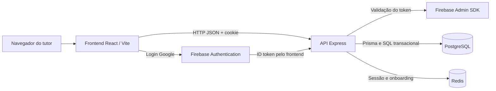
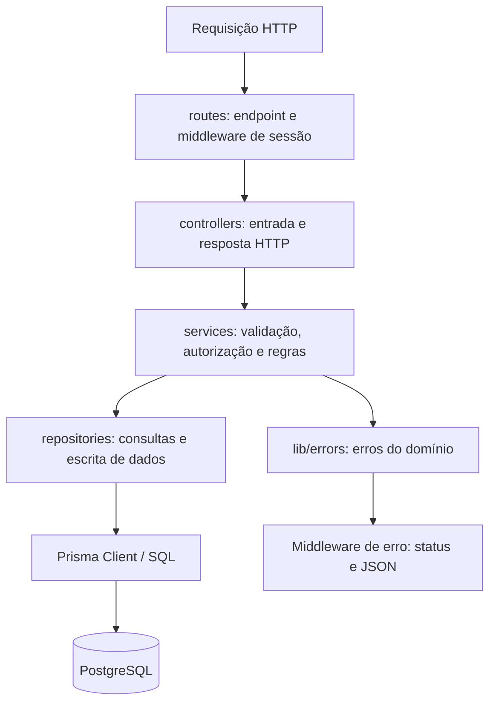

# Arquitetura do sistema

[Índice da documentação](../README.md) · [Banco de dados](../banco-de-dados/README.md) · [API](../api/README.md)

## Visão geral

O PetExpress é um monorepo com uma aplicação web React e uma API Express organizada em camadas. A API concentra regras de negócio e autorização; PostgreSQL armazena os dados do domínio e Redis mantém as sessões e o onboarding temporário. O frontend consome a API por HTTP/JSON.

Firebase participa do login Google. Depois da validação, a API emite a sessão própria do PetExpress, usada também no login com senha.

## Organização do monorepo

| Diretório | Responsabilidade |
| --- | --- |
| [`apps/frontend`](../../apps/frontend) | Interface, rotas, formulários, estado de autenticação e consumo da API |
| [`apps/backend`](../../apps/backend) | HTTP, autorização, regras de negócio, persistência e testes |
| [`apps/frontend-html`](../../apps/frontend-html) | Protótipos históricos de referência; não é a aplicação executada pelo Vite |
| [`packages/eslint-config`](../../packages/eslint-config) | Regras compartilhadas de lint |
| [`packages/tsconfig`](../../packages/tsconfig) | Bases compartilhadas de TypeScript |

O [workspace pnpm](../../pnpm-workspace.yaml) reúne `apps/*` e `packages/*`. Os scripts da raiz delegam tarefas ao Turborepo conforme [`turbo.json`](../../turbo.json): `build` depende dos builds de dependências e registra `dist/**` como saída; `dev` é persistente e não usa cache. Os módulos de negócio executam na mesma API.

## Frontend

O ponto de entrada é [`main.tsx`](../../apps/frontend/src/main.tsx), e [`App.tsx`](../../apps/frontend/src/App.tsx) define as rotas com React Router.

| Área em `apps/frontend/src/` | Papel |
| --- | --- |
| `pages/` | Páginas de início, cadastro, login, serviços, consultas e perfil |
| `components/` | Layout, componentes de formulário, perfil e interface compartilhada |
| `auth/` | Contexto de sessão, carregamento do perfil e tratamento de acesso privado |
| `booking/` | Seleção, carregamento de disponibilidade, prévia e envio de agendamento |
| `lib/api.ts` | Fetch com cookies, JSON e erro HTTP padronizado |
| `lib/booking.ts` e `lib/fidelidade.ts` | Helpers de seleção e cotação |
| `types/` | Contratos TypeScript de agenda e agendamento |
| `content/` | Conteúdo de apresentação, incluindo material ilustrativo da home |
| `index.css` | Tailwind e tokens de cor, tipografia, espaçamento e componentes visuais |

Rotas públicas: `/`, `/login`, `/cadastro` e `/cadastro/google/cpf`. Serviços, consultas e perfil usam `ProtectedRoute`. `/meus-pets` e `/meu-perfil` renderizam a mesma página de perfil/pets. A proteção de tela orienta a navegação; a autorização dos dados é aplicada novamente pela API.

As telas de serviços e consultas compartilham a lógica de agendamento. A rota ativa de serviços utiliza `BookingPage`; `ServiceBookingPage` não está ligada à rota atual. Mudanças na seleção invalidam horário/cotação e respostas antigas são descartadas para evitar exibir dados de outra seleção.

## Backend

[`server.ts`](../../apps/backend/src/server.ts) carrega o ambiente, conecta ao Redis e inicia o servidor. [`app.ts`](../../apps/backend/src/app.ts) monta Express, JSON, CORS, Swagger, rotas e tratamento central de erros.

As camadas são uma convenção de organização, com serviços complexos também acessando Prisma em transações. Helpers em `lib/` concentram validação, senhas, sessão, autorização, datas e cliente de banco. `config/` contém ambiente e OpenAPI; `commands/` reúne bootstrap de ADMIN e auditorias de legado.

### Módulos do domínio

| Módulo | Responsabilidade |
| --- | --- |
| Identidade | Cadastro, senha, Google, sessão, completude de perfil e autorização |
| Tutores e pets | Dados pessoais, endereços, animais e titularidade |
| Catálogo e equipe | Serviços, categorias, ativação e habilitação de profissionais |
| Agenda | Expediente, bloqueios, disponibilidade, contrato, estados e eventos de auditoria |
| Fidelidade | Contagem de banhos, emissão, reserva, consumo, liberação e ajuste de benefícios |
| Planos e assinaturas | Cadastros e vínculos existentes no modelo e nas APIs; sem fluxo de pagamento implementado |

## Sessão e permissões

No login com senha, a API verifica o hash bcrypt e cria um token aleatório. Redis armazena `sessao:<token>` com o ID do usuário, por 30 dias. O cookie `petshop_session` é HttpOnly; o navegador envia cookies nas requisições com `credentials: include`.

A cada acesso privado, a API busca o usuário no PostgreSQL e reavalia papel, vínculo com funcionário e completude do perfil. Esses dados não ficam congelados na sessão. O onboarding Google usa `petshop_onboarding`, separado da sessão comum, por 30 minutos.

| Papel | Escopo |
| --- | --- |
| Visitante | Cadastro/login, catálogo público, profissionais habilitados e consulta pública de disponibilidade |
| CLIENTE | Próprio perfil, endereços, pets, agendamentos e saldo de fidelidade |
| FUNCIONARIO | Agenda vinculada ao próprio cadastro profissional e transições autorizadas de atendimento |
| ADMIN | Cadastros administrativos, agenda, configuração, bloqueios e ajustes de fidelidade |

Clientes incompletos podem consultar/atualizar `/auth/me` e sair; recursos privados que exigem perfil completo retornam `403 PERFIL_INCOMPLETO`. A matriz detalhada está no [documento de identidade e autorização](../fase-1-identidade-autorizacao.md).

## Fluxo de um agendamento

1. A interface carrega os pets do tutor, o catálogo e a disponibilidade calculada pela API.
2. A seleção de pet, serviço, profissional e início gera uma prévia em `POST /agendamentos/previa`.
3. O servidor calcula preço base, desconto de fidelidade e total. A interface apresenta esses valores para confirmação.
4. A criação envia a seleção e `cotacaoEsperada`; titular, fim, preço efetivo, duração e estado são definidos no servidor.
5. Em transação, a API valida a disponibilidade, grava o agendamento, reserva eventual benefício e registra as auditorias.
6. A confirmação visual aparece após a persistência. Se outro pedido ocupar o horário ou a cotação mudar, a API retorna `409` e a interface pede uma nova escolha/confirmação.

## Concorrência, auditoria e erros

As escritas de agenda, catálogo e habilitações usam `pg_advisory_xact_lock(30003)` para serialização transacional. Alterações de uma reserva também usam bloqueio de linha. O PostgreSQL impede sobreposição por profissional através de exclusão GiST, mesmo se houver escrita fora da API. Esse lock global prioriza consistência e limita a capacidade de escrita concorrente.

Agendamento, evento, movimento e saldo de fidelidade são alterados na mesma transação. Uma falha reverte a operação inteira. `EventoAgendamento` registra ações na reserva; `MovimentoFidelidade` registra alterações do programa de benefícios.

O middleware de erros responde com `message` e, quando aplicável, `code` e `fieldErrors`. O frontend distingue falha de rede de erro HTTP e preserva os dados válidos do formulário. Consulte os [contratos HTTP](../api/README.md) e as [restrições do banco](../banco-de-dados/README.md#integridade-e-concorrência).

## Limites atuais

Há APIs administrativas, mas ainda não existe painel visual de equipe/administração. Pagamentos e prontuário não estão implementados; planos/assinaturas existentes não significam cobrança integrada. Os dados ilustrativos da home e os protótipos HTML não representam registros operacionais do banco.
