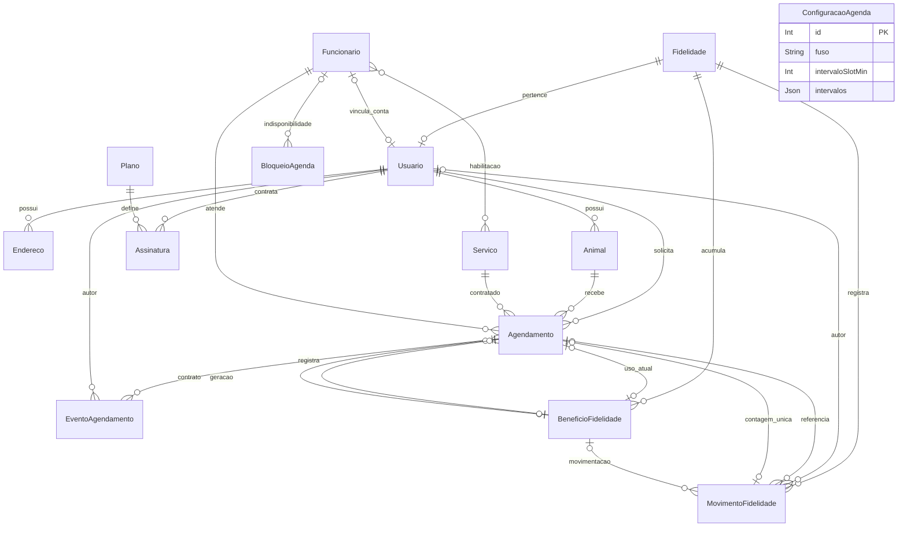

# Banco de dados

[Índice da documentação](../README.md) · [Arquitetura](../arquitetura/README.md) · [Desenvolvimento](../desenvolvimento/README.md)

## Persistência

O domínio é persistido em **PostgreSQL 16**, acessado pelo **Prisma Client** e por SQL nas operações que exigem locks ou restrições específicas. O [schema Prisma](../../apps/backend/prisma/schema.prisma) descreve entidades e relações; as [migrações SQL](../../apps/backend/prisma/migrations) também definem checks, exclusão GiST e triggers que não aparecem integralmente no schema.

**Redis 7** guarda sessões e dados temporários de onboarding. Usuários, pets, reservas e benefícios ficam no PostgreSQL. O Compose persiste os dados locais nos volumes `postgres_data` e `redis_data`.

## Diagrama de entidades

O diagrama usa os nomes dos modelos Prisma e destaca os vínculos do domínio. Os nomes físicos de tabela estão no dicionário abaixo. `ConfiguracaoAgenda` é uma configuração global, sem chave estrangeira para as outras entidades.



Cada usuário exige uma fidelidade exclusiva; a relação inversa permite uma fidelidade sem usuário. Uma conta pode ter vínculo exclusivo e opcional com um funcionário. A habilitação de profissionais para serviços é uma relação muitos para muitos, materializada por Prisma na tabela `_Habilitacao`.

## Dicionário de dados

Todos os modelos possuem `id` inteiro como chave primária. Em geral ele é autoincremental; a configuração global usa exclusivamente `id = 1`. `?` indica campo opcional/nulo. Consulte o schema para os tipos e defaults completos.

### Identidade e cadastros

| Modelo / tabela | Campos principais | Finalidade e vínculos |
| --- | --- | --- |
| `Usuario` / `usuarios` | `nome`, `email?`, `cpf`, `telefone?`, `senhaHash`, `role`, `funcionarioId?`, `fidelidadeId` | Conta de acesso; CPF e e-mail únicos; fidelidade exclusiva; vínculo opcional e único com funcionário |
| `Endereco` / `enderecos` | `cep`, `rua`, `bairro`, `numero`, `complemento?`, `usuarioId` | Endereços do tutor; um usuário pode ter vários |
| `Animal` / `animais` | `nome`, `especie`, `raca?`, `idade`, `porte`, `usuarioId` | Pets de um único tutor; podem ter vários agendamentos |
| `Funcionario` / `funcionarios` | `nome`, `cargo`, `telefone?`, `ativo` | Profissional que atende serviços explicitamente habilitados |
| `Servico` / `servicos` | `nome`, `descricao?`, `categoria?`, `ativo`, `duracaoMin`, `preco`, `elegivelFidelidade` | Catálogo de atendimentos; serviços ativos precisam de categoria |
| `Plano` / `planos` | `preco`, `tipo` | Definição de plano de assinatura |
| `Assinatura` / `assinaturas` | `dataAquisicao`, `servicosRest?`, `usuarioId`, `planoId` | Vínculo do usuário com um plano; saldo de serviços em JSON opcional |

`senhaHash` é o hash da senha, sem retorno nos contratos públicos. `email` e `telefone` aceitam nulo no banco para compatibilidade com legado; a validação de cadastro/completude impõe os requisitos atuais na aplicação. Campos `usuarioId`, `funcionarioId`, `fidelidadeId`, `animalId`, `servicoId` e `planoId` em modelos antigos usam mapeamentos físicos `id_usuario`, `id_funcionario` etc., conforme `@map` no schema.

### Agenda e auditoria

| Modelo / tabela | Campos principais | Finalidade e vínculos |
| --- | --- | --- |
| `Agendamento` / `agendamentos` | `dataHoraIni`, `dataHoraFim`, `status`, `observacoes?`, `usuarioId`, `animalId`, `servicoId`, `funcionarioId` | Reserva com tutor, pet, serviço e profissional obrigatórios |
| `ConfiguracaoAgenda` / `configuracao_agenda` | `fuso`, `intervaloSlotMin`, `antecedenciaCriacaoHoras`, `antecedenciaCancelamentoHoras`, `antecedenciaReagendamentoHoras`, `intervalos` | Fuso, grade, expediente e prazos globais |
| `BloqueioAgenda` / `bloqueios_agenda` | `inicio`, `fim`, `motivo?`, `funcionarioId?` | Indisponibilidade de um profissional ou de toda a operação quando o vínculo é nulo |
| `EventoAgendamento` / `eventos_agendamento` | `agendamentoId`, `autorId`, `instante`, `acao`, `motivo?`, `antes?`, `depois` | Auditoria de criação, alteração e transição de estado, com snapshots JSON |

O contrato da reserva também guarda `duracaoContratadaMin`, `precoBase?`, `desconto`, `precoContratado?`, `elegivelFidelidade` e `beneficioId?`. Mudanças posteriores no catálogo não reescrevem o contrato. Preços históricos desconhecidos permanecem nulos; `duracaoContratadaMin` é `Float` para preservar frações de minuto legadas.

Valores monetários usam `Decimal(10, 2)`. Instantes de agendamento são persistidos em UTC nas colunas timestamp existentes; regras e datas locais da agenda usam `America/Sao_Paulo`. `dataAquisicao` de assinatura usa `Date`.

### Fidelidade

| Modelo / tabela | Campos principais | Finalidade e vínculos |
| --- | --- | --- |
| `Fidelidade` / `fidelidades` | `progresso`, `qntdServicos`, `beneficioAtivo` | Saldo do tutor, compartilhado entre seus pets; progresso de 0 a 7 |
| `BeneficioFidelidade` / `beneficios_fidelidade` | `fidelidadeId`, `estado`, `criadoEm`, `geradorId?`, `agendamentoId?` | Benefício individual, com geração e uso atual opcionais e únicos |
| `MovimentoFidelidade` / `movimentos_fidelidade` | `fidelidadeId`, `tipo`, `instante`, `autorId?`, `motivo?`, `antes`, `depois`, `beneficioId?`, `agendamentoId?`, `contagemAgendamentoId?` | Histórico auditável de cada alteração, com contagem única por agendamento |

`qntdServicos` espelha o progresso atual, e `beneficioAtivo` é uma projeção da existência de benefícios disponíveis. O cálculo do benefício considera os registros individuais de `BeneficioFidelidade`.

Há três relações distintas entre benefício e agendamento: o atendimento que **gerou** o benefício (`geradorId`), o **uso atual** reservado/consumido (`agendamentoId`) e o **contrato histórico** (`Agendamento.beneficioId`). Ao cancelar, o benefício pode voltar a ficar disponível e ser reutilizado; o contrato cancelado mantém a referência e os valores originais.

### Enumerações

| Enum | Valores |
| --- | --- |
| `Role` | `CLIENTE`, `FUNCIONARIO`, `ADMIN` |
| `CategoriaServico` | `BANHO_TOSA`, `CONSULTA` |
| `StatusAgendamento` | `AGENDADO`, `CONCLUIDO`, `CANCELADO`, `NAO_COMPARECEU` |
| `Porte` | `PEQUENO`, `MEDIO`, `GRANDE` |
| `TipoPlano` | `BASICO`, `PADRAO`, `PREMIUM` |
| `EstadoBeneficio` | `DISPONIVEL`, `RESERVADO`, `CONSUMIDO`, `REVOGADO` |
| `TipoMovimentoFidelidade` | `IMPORTACAO`, `CONTAGEM`, `EMISSAO`, `RESERVA`, `LIBERACAO`, `CONSUMO`, `AJUSTE` |

## Integridade e concorrência

As chaves estrangeiras preservam os vínculos. Endereços e animais têm `onDelete: Cascade` em relação ao usuário; referências de agendamento, assinatura e auditoria usam `Restrict`, de modo que histórico vinculado pode impedir a exclusão. Os serviços também validam vínculos antes de remover registros.

Além das FKs e índices de unicidade, as migrações mantêm:

- **Agenda sem sobreposição:** exclusão GiST por profissional, com extensão `btree_gist`, para estados `AGENDADO` e `CONCLUIDO`. O intervalo é semiaberto `[início, fim)`, permitindo atendimentos adjacentes.
- **Intervalos válidos:** fim posterior ao início, duração contratada positiva e bloqueios com duração positiva.
- **Configuração global:** apenas `id = 1`, slots e antecedências positivos.
- **Classificação:** serviço ativo precisa de categoria; fidelidade só pode ser habilitada em `BANHO_TOSA`.
- **Contrato financeiro:** preço final igual ao preço base menos desconto; benefício aplicado exige elegibilidade e desconto integral.
- **Saldo consistente:** progresso entre 0 e 7 e igual ao contador de compatibilidade.
- **Contagem sem duplicidade:** unicidade da contagem, do atendimento gerador e do vínculo de uso de benefício.
- **Auditoria:** movimentos exigem autor, exceto importação; ajustes exigem motivo. Triggers diferidos validam titularidade, reciprocidade e estado dos vínculos ao fim da transação.

A API combina essas restrições com transações e `pg_advisory_xact_lock(30003)`. Disponibilidade é uma consulta momentânea; só a escrita transacional confirma a reserva. A exclusão SQL não substitui as regras da aplicação sobre expediente, prazos e habilitação.

Índices adicionais atendem consultas de bloqueios por intervalo, eventos por agendamento/instante, benefícios por fidelidade/estado/ordem de criação e movimentos por fidelidade/instante/ID.

## Migrações

| Migração | Mudança |
| --- | --- |
| `20260927231723_dominio_petshop` | Entidades iniciais do domínio |
| `20261022000000_identidade_autorizacao` | Identidade normalizada, telefone e vínculo de funcionário |
| `20261022010000_animal_raca` | Raça opcional do animal |
| `20261027000000_agenda_real` | Catálogo ativo, habilitações, configuração, bloqueios, contrato, estados, eventos e exclusão GiST |
| `20261028000000_fidelidade_automatica` | Benefícios individuais, movimentos, contratos financeiros e importação auditada de legado |

Em base nova, após configurar `DATABASE_URL`:

```bash
pnpm --filter @petshop/backend prisma:generate
pnpm --filter @petshop/backend exec prisma migrate deploy
pnpm --filter @petshop/backend exec prisma migrate status
```

Para uma base existente, faça backup e suspenda escritas durante a atualização. Antes de migrar, execute as auditorias somente leitura apontando para a base pretendida:

```bash
pnpm --filter @petshop/backend auditoria:legado
pnpm --filter @petshop/backend auditoria:agenda
pnpm --filter @petshop/backend auditoria:fidelidade
```

Resolva os conflitos identificados antes de aplicar migrações. Elas abortam em dados inválidos, sem corrigir silenciosamente colisões de identidade, reservas sobrepostas ou contadores fora de 0–7. Serviços/profissionais legados começam inativos; contratos antigos não recebem conclusão ou elegibilidade presumida.

Use `prisma migrate dev` para **criar uma nova migração durante o desenvolvimento**. Para aplicar as existentes, use `migrate deploy`. Não substitua esse fluxo por `db push`: as restrições SQL adicionais fazem parte do modelo. O usuário do banco precisa poder instalar `btree_gist`, ou a extensão deve ser disponibilizada pelo operador.

Consulte os procedimentos de [identidade](../google-auth.md), [agenda](../agenda-operacao.md) e [fidelidade](../fase4-implementacao.md) para o tratamento de legado.
